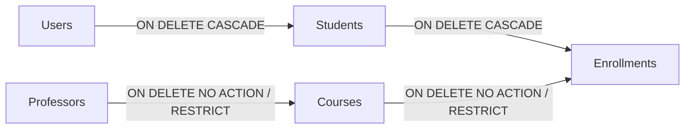

# Arquitectura de la Base de Datos: Especificación Técnica, Modelo Relacional y Justificaciones de Diseño

**Sistema:** Plataforma de Registro Académico y Selección de Materias  
**Motor de Persistencia:** Microsoft SQL Server 2022+ / Azure SQL Database  
**ORM & Acceso a Datos:** Entity Framework Core 8 (Code-First / Reverse Configuration)  
**Organización:** Inter Rapidísimo S.A.  
**Estado:** Producción / Esquema Validado e Idempotente  

---

## 1. Visión General del Modelo de Persistencia

El modelo de persistencia del sistema está diseñado bajo el paradigma **Relacional Estricto (RDBMS)**, garantizando el cumplimiento pleno de las propiedades **ACID** (Atomicidad, Consistencia, Aislamiento y Durabilidad) requeridas para la gestión transaccional de inscripciones académicas y control de accesos.

### Objetivos Estratégicos del Diseño
* **Integridad Referencial Absoluta:** Ningún registro de inscripción, curso o usuario puede existir en un estado huérfano o inconsistente.
* **Seguridad Contra Enumeración Maliciosa:** Uso de identificadores universales únicos (`UNIQUEIDENTIFIER`) para evitar ataques de recolección secuencial (IDOR / Insecure Direct Object References).
* **Rendimiento de E/S Optimizado:** Mitigación de la fragmentación de páginas en índices clustered mediante claves secuenciales (`NEWSEQUENTIALID()`).
* **Auditoría Temporal Inmutable:** Trazabilidad canónica universal con sellos de tiempo UTC (`DATETIMEOFFSET`) y eliminación lógica (*Soft-Delete*) controlada por índices filtrados.

---

## 2. Diagrama Entidad-Relación (Mermaid ERD)

El siguiente diagrama documenta la topología de entidades, tipos de datos físicos en T-SQL, claves primarias, foráneas, índices de unicidad y la cardinalidad de sus relaciones.

```mermaid
erDiagram
    USERS ||--o| STUDENTS : "1:1 (Especialización)"
    PROFESSORS ||--o{ COURSES : "1:N (Asignación docente)"
    STUDENTS ||--o{ ENROLLMENTS : "1:N (Historial y activas)"
    COURSES ||--o{ ENROLLMENTS : "1:N (Estudiantes inscritos)"

    USERS {
        UNIQUEIDENTIFIER Id PK "NEWSEQUENTIALID()"
        NVARCHAR_150 FullName "Nombre y apellidos completos"
        NVARCHAR_150 Email UK "Correo institucional único"
        NVARCHAR_256 PasswordHash "Hash criptográfico PBKDF2"
        NVARCHAR_30 Role "Estudiante | Administrador"
        DATETIMEOFFSET CreatedAtUtc "Sello de creación UTC"
        DATETIMEOFFSET UpdatedAtUtc "Sello de última modificación"
        BIT IsDeleted "Bandera de borrado lógico"
    }

    STUDENTS {
        UNIQUEIDENTIFIER Id PK_FK "Identificador compartido con Users"
        NVARCHAR_50 IdentificationNumber UK "Documento de identidad nacional"
        DATETIMEOFFSET CreatedAtUtc "Sello de creación UTC"
        DATETIMEOFFSET UpdatedAtUtc "Sello de última modificación"
        BIT IsDeleted "Bandera de borrado lógico"
    }

    PROFESSORS {
        UNIQUEIDENTIFIER Id PK "NEWSEQUENTIALID()"
        NVARCHAR_150 FullName "Nombre completo del docente"
        NVARCHAR_150 Email UK "Correo de contacto único"
        BIT IsAvailable "Disponibilidad académica activa"
        DATETIMEOFFSET CreatedAtUtc "Sello de creación UTC"
        DATETIMEOFFSET UpdatedAtUtc "Sello de última modificación"
        BIT IsDeleted "Bandera de borrado lógico"
    }

    COURSES {
        UNIQUEIDENTIFIER Id PK "NEWSEQUENTIALID()"
        NVARCHAR_20 Code UK "Código nemotécnico de materia"
        NVARCHAR_150 Name "Denominación curricular"
        INT Credits "Valor del crédito académico (=3)"
        UNIQUEIDENTIFIER ProfessorId FK "Docente responsable asignado"
        DATETIMEOFFSET CreatedAtUtc "Sello de creación UTC"
        DATETIMEOFFSET UpdatedAtUtc "Sello de última modificación"
        BIT IsDeleted "Bandera de borrado lógico"
    }

    ENROLLMENTS {
        UNIQUEIDENTIFIER Id PK "NEWSEQUENTIALID()"
        UNIQUEIDENTIFIER StudentId FK "Estudiante matriculado"
        UNIQUEIDENTIFIER CourseId FK "Materia matriculada"
        DATETIMEOFFSET EnrolledAtUtc "Momento exacto de matrícula"
        DATETIMEOFFSET CreatedAtUtc "Sello de creación UTC"
        DATETIMEOFFSET UpdatedAtUtc "Sello de última modificación"
        BIT IsDeleted "Bandera de borrado lógico"
    }
```

---

## 3. Diccionario de Datos y Especificación de Tablas

### 3.1. Tabla: `dbo.Users`
Almacena las identidades y credenciales de autenticación del sistema. Soporta tanto administradores como estudiantes.

| Columna | Tipo T-SQL | Nulabilidad | Claves / Restricciones | Propósito y Justificación |
| :--- | :--- | :---: | :--- | :--- |
| `Id` | `UNIQUEIDENTIFIER` | NOT NULL | `PK_Users` (Clustered)<br>`DEFAULT NEWSEQUENTIALID()` | Identificador universal único generado de forma secuencial por el motor. |
| `FullName` | `NVARCHAR(150)` | NOT NULL | Longitud controlada | Nombre y apellidos del usuario. Unicode compatible (`NVARCHAR`). |
| `Email` | `NVARCHAR(150)` | NOT NULL | `UQ_Users_Email` (Unique Index) | Identificador de inicio de sesión. No admite duplicados. |
| `PasswordHash` | `NVARCHAR(256)` | NOT NULL | Criptografía segura | Almacenamiento de hash PBKDF2 con salting e iteraciones criptográficas. |
| `Role` | `NVARCHAR(30)` | NOT NULL | `Estudiante` \| `Administrador` | Rol del usuario para autorización RBAC en frontend y backend. |
| `CreatedAtUtc` | `DATETIMEOFFSET` | NOT NULL | `DEFAULT SYSDATETIMEOFFSET()` | Fecha y hora UTC inmutable de creación. |
| `UpdatedAtUtc` | `DATETIMEOFFSET` | NULL | Auditoría de actualización | Timestamp de última edición física o lógica. |
| `IsDeleted` | `BIT` | NOT NULL | `DEFAULT 0` | Bandera binaria para exclusión lógica en consultas activas. |

### 3.2. Tabla: `dbo.Students`
Extensión de perfil para usuarios con rol de estudiante. Implementa el patrón de especialización 1:1 con `Users`.

| Columna | Tipo T-SQL | Nulabilidad | Claves / Restricciones | Propósito y Justificación |
| :--- | :--- | :---: | :--- | :--- |
| `Id` | `UNIQUEIDENTIFIER` | NOT NULL | `PK_Students` (Clustered)<br>`FK_Students_Users (Id)`<br>`ON DELETE CASCADE` | Llave primaria y foránea compartida que hereda el identificador de `Users`. |
| `IdentificationNumber` | `NVARCHAR(50)` | NOT NULL | `UQ_Students_IdentificationNumber` | Número de cédula o documento de identidad institucional único. |
| `CreatedAtUtc` | `DATETIMEOFFSET` | NOT NULL | `DEFAULT SYSDATETIMEOFFSET()` | Fecha y hora UTC inmutable de registro estudiantil. |
| `UpdatedAtUtc` | `DATETIMEOFFSET` | NULL | Auditoría de actualización | Timestamp de actualización. |
| `IsDeleted` | `BIT` | NOT NULL | `DEFAULT 0` | Borrado lógico sincronizado. |

### 3.3. Tabla: `dbo.Professors`
Catálogo de docentes titulares de las materias académicas.

| Columna | Tipo T-SQL | Nulabilidad | Claves / Restricciones | Propósito y Justificación |
| :--- | :--- | :---: | :--- | :--- |
| `Id` | `UNIQUEIDENTIFIER` | NOT NULL | `PK_Professors` (Clustered)<br>`DEFAULT NEWSEQUENTIALID()` | Llave primaria universal del docente. |
| `FullName` | `NVARCHAR(150)` | NOT NULL | Longitud controlada | Nombre y apellidos del profesor. |
| `Email` | `NVARCHAR(150)` | NOT NULL | `UQ_Professors_Email` (Unique) | Correo de contacto institucional único del docente. |
| `IsAvailable` | `BIT` | NOT NULL | `DEFAULT 1` | Indicador de disponibilidad operativa para asignación de cátedra. |
| `CreatedAtUtc` | `DATETIMEOFFSET` | NOT NULL | `DEFAULT SYSDATETIMEOFFSET()` | Fecha de creación del registro. |
| `UpdatedAtUtc` | `DATETIMEOFFSET` | NULL | Auditoría de actualización | Modificación del registro docente. |
| `IsDeleted` | `BIT` | NOT NULL | `DEFAULT 0` | Borrado lógico docente. |

### 3.4. Tabla: `dbo.Courses`
Catálogo de materias académicas disponibles para el proceso de inscripción.

| Columna | Tipo T-SQL | Nulabilidad | Claves / Restricciones | Propósito y Justificación |
| :--- | :--- | :---: | :--- | :--- |
| `Id` | `UNIQUEIDENTIFIER` | NOT NULL | `PK_Courses` (Clustered)<br>`DEFAULT NEWSEQUENTIALID()` | Llave primaria de la materia. |
| `Code` | `NVARCHAR(20)` | NOT NULL | `UQ_Courses_Code` (Unique Index) | Código curricular nemotécnico único (ej. `MAT-101`, `BD-401`). |
| `Name` | `NVARCHAR(150)` | NOT NULL | Longitud controlada | Nombre oficial de la asignatura. |
| `Credits` | `INT` | NOT NULL | `CK_Courses_Credits (Credits = 3)`<br>`DEFAULT 3` | Valor crediticio de la materia. Fijo en 3 según especificación. |
| `ProfessorId` | `UNIQUEIDENTIFIER` | NOT NULL | `FK_Courses_Professors`<br>`ON DELETE NO ACTION` | Llave foránea del docente responsable de la cátedra. |
| `CreatedAtUtc` | `DATETIMEOFFSET` | NOT NULL | `DEFAULT SYSDATETIMEOFFSET()` | Fecha de registro en el catálogo curricular. |
| `UpdatedAtUtc` | `DATETIMEOFFSET` | NULL | Auditoría de actualización | Fecha de última alteración de contenidos. |
| `IsDeleted` | `BIT` | NOT NULL | `DEFAULT 0` | Borrado lógico de asignatura. |

### 3.5. Tabla: `dbo.Enrollments`
Entidad asociativa que resuelve la relación muchos a muchos ($N:M$) entre estudiantes y materias, registrando el evento de inscripción.

| Columna | Tipo T-SQL | Nulabilidad | Claves / Restricciones | Propósito y Justificación |
| :--- | :--- | :---: | :--- | :--- |
| `Id` | `UNIQUEIDENTIFIER` | NOT NULL | `PK_Enrollments` (Clustered)<br>`DEFAULT NEWSEQUENTIALID()` | Llave primaria del comprobante de inscripción. |
| `StudentId` | `UNIQUEIDENTIFIER` | NOT NULL | `FK_Enrollments_Students`<br>`ON DELETE CASCADE` | Llave foránea que referencia al estudiante matriculado. |
| `CourseId` | `UNIQUEIDENTIFIER` | NOT NULL | `FK_Enrollments_Courses`<br>`ON DELETE NO ACTION` | Llave foránea que referencia la materia seleccionada. |
| `EnrolledAtUtc` | `DATETIMEOFFSET` | NOT NULL | `DEFAULT SYSDATETIMEOFFSET()` | Fecha y hora exacta de la inscripción. |
| `CreatedAtUtc` | `DATETIMEOFFSET` | NOT NULL | `DEFAULT SYSDATETIMEOFFSET()` | Registro de auditoría del evento. |
| `UpdatedAtUtc` | `DATETIMEOFFSET` | NULL | Auditoría de actualización | Timestamp de modificación de la inscripción. |
| `IsDeleted` | `BIT` | NOT NULL | `DEFAULT 0` | Bandera de baja lógica o cancelación de materia. |

---

## 4. Justificaciones Técnicas de Arquitectura de Datos

### 4.1. Estrategia de Claves Primarias: `UNIQUEIDENTIFIER` con `NEWSEQUENTIALID()`

> [!NOTE]
> En bases de datos distribuidas o expuestas mediante APIs REST, el uso de claves enteras secuenciales (`INT IDENTITY(1,1)`) introduce vulnerabilidades de seguridad y limitaciones arquitectónicas.

#### Justificación frente a Claves Enteras Secuenciales (`INT` / `BIGINT`):
1. **Mitigación de Ataques IDOR (Insecure Direct Object Reference):** Un identificador entero permite a atacantes predecir rutas como `/api/v1/students/1`, `/api/v1/students/2` mediante técnicas de scraping o enumeración. Un GUID de 128 bits hace computacionalmente inviable la inferencia de recursos ajenos.
2. **Generación Descentralizada y Migraciones:** Permite pre-generar identificadores en capas de aplicación, pruebas de integración o seeds deterministas sin requerir un viaje de ida y vuelta a la base de datos para obtener el `SCOPE_IDENTITY()`.

#### Justificación de `NEWSEQUENTIALID()` frente a `NEWID()`:
* **Mitigación de Fragmentación de Páginas (B-Tree Page Splits):** Un `NEWID()` genera valores completamente aleatorios en memoria. Al indexar por un clustered index B-Tree, cada inserción aleatoria fuerza al motor a partir páginas de datos existentes en el disco (*page splitting*), degradando drásticamente el rendimiento de inserción y aumentando el uso de memoria caché en el buffer pool.
* `NEWSEQUENTIALID()` genera GUIDs secuenciales basados en la dirección MAC del host y una secuencia monótona creciente, garantizando que las nuevas inserciones se añadan al final del árbol B-Tree como un índice agrupado tradicional, conservando la velocidad de inserción y minimizando la fragmentación física.

---

### 4.2. Patrón de Especialización de Entidades: Herencia `Users` y `Students` (1:1 Compartido)

Para modelar la relación entre una cuenta de acceso y un estudiante se adoptó el patrón **Table-per-Type (TPT)** mediante **Shared Primary Key**:

```
                    ┌────────────────────────┐
                    │       dbo.Users        │
                    │  PK: Id (GUID)         │
                    │  Email, PasswordHash   │
                    │  Role: 'Estudiante'    │
                    └───────────┬────────────┘
                                │ 1:1
                                │ PK = FK (Id)
                                ▼
                    ┌────────────────────────┐
                    │      dbo.Students      │
                    │  PK / FK: Id (GUID)    │
                    │  IdentificationNumber  │
                    └────────────────────────┘
```

#### Justificaciones Técnicas:
1. **Eliminación de Columnas Nulas en `Users`:** Si se hubiese unificado todo en la tabla `Users`, los usuarios con rol `Administrador` tendrían columnas académicas como `IdentificationNumber` en valor `NULL`, violando el principio de diseño limpio y dificultando restricciones de unicidad absolutas sobre dicho atributo.
2. **Segregación de Responsabilidades:** La tabla `Users` atiende exclusivamente la autenticación, tokens JWT y seguridad. La tabla `Students` atiende el dominio académico y se conecta al historial de inscripciones.
3. **Consistencia de Clave Compartida:** Al asignar `Students.Id = Users.Id`, no se requiere una clave foránea artificial extra ni columnas redundantes; la consulta de unión `Users JOIN Students ON Users.Id = Students.Id` es un join directo por clave primaria agrupada de costo $O(1)$.

---

### 4.3. Estrategia de Índices e Integridad: Restricción Única Filtrada con Soft-Delete

Uno de los desafíos clásicos del borrado lógico (*Soft-Delete*) en motores relacionales es la preservación de restricciones de unicidad.

#### El Problema de la Restricción Convencional:
Si un estudiante inscribe una materia (`StudentId = A, CourseId = B`) y posteriormente la cancela (`IsDeleted = 1`), una restricción `UNIQUE (StudentId, CourseId)` estándar en SQL impediría que el estudiante vuelva a inscribir la misma materia en el futuro, o impediría que múltiples registros cancelados coexistan en el historial.

#### La Solución Implementada: Índice Único Filtrado (Filtered Index)
```sql
CREATE UNIQUE NONCLUSTERED INDEX [UQ_Enrollments_ActiveStudentCourse]
ON [dbo].[Enrollments] ([StudentId] ASC, [CourseId] ASC)
WHERE [IsDeleted] = 0;
```

#### Beneficios Técnicos:
* **Integridad Garantizada:** En cualquier instante de tiempo, un estudiante solo puede tener como máximo **una inscripción activa** para un curso específico.
* **Historial Preservado:** Si una materia fue cancelada (`IsDeleted = 1`), el índice filtrado ignora dicho registro, permitiendo la re-inscripción sin conflictos.
* **Espacio y Rendimiento:** El índice solo indiza filas donde `IsDeleted = 0`, lo que reduce su huella de memoria en RAM en comparación con un índice que cubra todo el histórico de cancelaciones.

---

### 4.4. Políticas de Integridad Referencial y Comportamiento ante Eliminación

La base de datos configura explícitamente las reglas de integridad referencial para evitar eliminaciones catastróficas o huérfanas:



| Relación | Acción Referencial | Justificación Técnica |
| :--- | :--- | :--- |
| `Users` $\to$ `Students` | `ON DELETE CASCADE` | Si una cuenta de usuario es purgada permanentemente, su perfil de estudiante asociado debe desaparecer de forma atómica. |
| `Students` $\to$ `Enrollments` | `ON DELETE CASCADE` | La eliminación definitiva de un estudiante limpia sus matrículas asociadas en una única transacción de motor. |
| `Professors` $\to$ `Courses` | `ON DELETE NO ACTION` (Restrict) | **Protección Curricular:** No es admisible eliminar a un docente si este tiene materias asociadas. La institución debe reasignar la cátedra o dar de baja las materias explícitamente. |
| `Courses` $\to$ `Enrollments` | `ON DELETE NO ACTION` (Restrict) | **Protección de Registro Académico:** No es admisible eliminar físicamente una asignatura si existen estudiantes inscritos en ella. Previene la pérdida inadvertida de créditos matriculados. |

---

### 4.5. Auditoría Canónica y Zonas Horarias: `DATETIMEOFFSET` y UTC

> [!IMPORTANT]
> Se prohibió de forma estricta el uso de tipos de datos ambiguos como `DATETIME` o `DATETIME2` sin información de zona horaria.

#### Justificación del Tipo `DATETIMEOFFSET`:
1. **Precisión Temporal Universal:** Almacena la fecha, la hora y el desfase de zona horaria respecto a UTC (ej. `2026-10-10T23:15:00.0000000+00:00`).
2. **Independencia del Servidor de Base de Datos:** Si la base de datos se migra de un servidor físico en Colombia (UTC-5) a un clúster en la nube en Azure Este de EE.UU. (UTC-4) o Europa (UTC+1), los sellos temporales conservan su valor cronológico exacto sin conversiones erróneas.
3. **Auditoría Transversal con `BaseEntity`:** Todas las tablas heredan de `BaseEntity` las columnas `CreatedAtUtc`, `UpdatedAtUtc` y `IsDeleted`, asegurando una convención homogénea a lo largo de todo el modelo relacional.

---

## 5. Análisis de Normalización (1NF a BCNF)

El esquema implementado se encuentra normalizado hasta la **Forma Normal de Boyce-Codd (BCNF)**, satisfaciendo cada uno de los niveles formales del álgebra relacional:

### Primera Forma Normal (1NF)
* **Atributos Atómicos:** Cada columna contiene valores indivisibles (no existen listas separadas por comas de materias en `Students`, ni arreglos JSON no relacionales para profesores).
* **Ausencia de Grupos Repetidos:** Las materias no se modelan como `Materia1`, `Materia2`, `Materia3` dentro de la tabla `Students`, sino mediante la relación asociativa en `Enrollments`.
* **Identificación Unívoca:** Toda tabla cuenta con una clave primaria formal.

### Segunda Forma Normal (2NF)
* Cumple 1NF.
* **Dependencia Funcional Total:** Todas las columnas que no forman parte de la clave primaria dependen por completo de la clave primaria completa. En la tabla asociativa `Enrollments`, el identificador primario es un GUID independiente `Id`, evitando dependencias parciales sobre claves compuestas.

### Tercera Forma Normal (3NF)
* Cumple 2NF.
* **Ausencia de Dependencias Transitivas:** Ningún atributo no clave depende funcionalmente de otro atributo no clave. Por ejemplo:
  * El nombre del profesor no se almacena en `Courses`, sino en `Professors`. `Courses` solo almacena `ProfessorId`.
  * La cédula del estudiante no se almacena en `Enrollments`, sino en `Students`. `Enrollments` solo almacena `StudentId`.
  * Los créditos de una materia no se copian ni calculan en `Enrollments`.

### Forma Normal de Boyce-Codd (BCNF)
* Toda dependencia funcional $X \to Y$ cumple con que $X$ es una superclave de la relación:
  * En `Users`: $Id \to \{FullName, Email, PasswordHash, Role\}$, $Email \to \{Id, \dots\}$.
  * En `Students`: $Id \to \{IdentificationNumber\}$, $IdentificationNumber \to \{Id\}$.
  * En `Courses`: $Id \to \{Code, Name, Credits, ProfessorId\}$, $Code \to \{Id, \dots\}$.

---

## 6. Cohesión entre Reglas de Negocio y Base de Datos

Las restricciones de negocio del sistema se garantizan mediante una estrategia de **Doble Barrera** (*Defense in Depth*):

```
┌────────────────────────────────────────────────────────┐
│            Capa de Dominio / Aplicación               │
│  - MaxCoursesSpecification (Límite 3 materias / 9 cred) │
│  - UniqueProfessorSpecification (No repetir docente)    │
│  - NotAlreadyEnrolledSpecification                     │
└───────────────────────────┬────────────────────────────┘
                            │ Validación previa bajo transacción
                            ▼
┌────────────────────────────────────────────────────────┐
│            Capa de Base de Datos (Motor SQL)           │
│  - CK_Courses_Credits CHECK (Credits = 3)              │
│  - UQ_Enrollments_ActiveStudentCourse (Filtered Index) │
│  - FK_Enrollments_Students / FK_Enrollments_Courses    │
└────────────────────────────────────────────────────────┘
```

1. **Restricción de Créditos por Materia:**
   * **Base de Datos:** `CONSTRAINT CK_Courses_Credits CHECK ([Credits] = 3)`. Ninguna inserción directa o vía script puede crear asignaturas con un valor distinto a 3 créditos.
2. **Restricción de Materias Duplicadas:**
   * **Base de Datos:** Índice filtrado `UQ_Enrollments_ActiveStudentCourse` sobre `(StudentId, CourseId)` activo.
   * **Dominio:** `NotAlreadyEnrolledSpecification` devuelve un error descriptivo legible al usuario antes de provocar una excepción de motor SQL.
3. **Límite de 3 Materias (9 Créditos Máximo):**
   * **Justificación de Diseño:** La validación de agregación (contar cuántas materias activas tiene ya el estudiante) se ejecuta a nivel de aplicación en `MaxCoursesSpecification` y `UnitOfWork` mediante una transacción con aislamiento de lectura comprometida, evitando bloqueos de tabla pesados (*Table Locks*) o triggers costosos en SQL Server.
4. **Conflicto de Profesor:**
   * **Justificación de Diseño:** Se resuelve dinámicamente mediante `UniqueProfessorSpecification` comparando el `ProfessorId` de la nueva materia contra los `ProfessorId` de los cursos activos del estudiante.

---

## 7. Estrategia de Índices de Rendimiento

Para garantizar tiempos de respuesta inferiores a $20\text{ ms}$ en operaciones de consulta de catálogo, listado de materias y validaciones de seguridad, se establecieron los siguientes índices:

| Nombre del Índice | Tabla | Columnas | Tipo | Propósito de Rendimiento |
| :--- | :--- | :--- | :--- | :--- |
| `PK_Users` | `Users` | `Id` (ASC) | Clustered | Búsqueda directa por GUID secuencial. |
| `UQ_Users_Email` | `Users` | `Email` (ASC) | Unique Non-Clustered | Búsqueda de alta velocidad durante el Login de usuario ($O(\log N)$). |
| `PK_Students` | `Students` | `Id` (ASC) | Clustered | Join inmediato $1:1$ con `Users`. |
| `UQ_Students_IdentificationNumber` | `Students` | `IdentificationNumber` (ASC) | Unique Non-Clustered | Búsqueda por documento en registros o consultas administrativas. |
| `PK_Professors` | `Professors` | `Id` (ASC) | Clustered | Clave primaria. |
| `UQ_Professors_Email` | `Professors` | `Email` (ASC) | Unique Non-Clustered | Unicidad de correo docente. |
| `PK_Courses` | `Courses` | `Id` (ASC) | Clustered | Clave primaria. |
| `UQ_Courses_Code` | `Courses` | `Code` (ASC) | Unique Non-Clustered | Búsqueda por código de materia (`MAT-101`). |
| `IX_Courses_ProfessorId` | `Courses` | `ProfessorId` (ASC) | Non-Clustered | Optimiza el JOIN `Courses INNER JOIN Professors` evitando Table Scans. |
| `PK_Enrollments` | `Enrollments` | `Id` (ASC) | Clustered | Clave primaria de inscripción. |
| `IX_Enrollments_StudentId` | `Enrollments` | `StudentId` (ASC) | Non-Clustered | Optimiza la consulta "Mis Materias" (`WHERE StudentId = @Id`). |
| `IX_Enrollments_CourseId` | `Enrollments` | `CourseId` (ASC) | Non-Clustered | Optimiza la consulta de compañeros o cupos (`WHERE CourseId = @Id`). |
| `UQ_Enrollments_ActiveStudentCourse` | `Enrollments` | `StudentId`, `CourseId` | Unique Non-Clustered (Filtered) | Unicidad estricta para inscripciones activas (`WHERE IsDeleted = 0`). |

---

## 8. Semillado Canónico e Idempotencia

El esquema cuenta con un script SQL declarativo e idempotente ubicado en [`database/scripts/01_init_schema_and_seeds.sql`](file:///c:/Users/alvar/Documents/Prueba%20inter/database/scripts/01_init_schema_and_seeds.sql) y un inicializador EF Core sincronizado en [`DbInitializer.cs`](file:///c:/Users/alvar/Documents/Prueba%20inter/src/backend/Adapters/Infrastructure/Persistence/DbInitializer.cs).

### Datos Semilla Garantizados:
* **5 Profesores Titulares:**
  1. `Prof. Andrés Gómez` (`andres.gomez@universidad.edu.co`)
  2. `Prof. Beatriz Morales` (`beatriz.morales@universidad.edu.co`)
  3. `Prof. Carlos Herrera` (`carlos.herrera@universidad.edu.co`)
  4. `Prof. Diana Ramírez` (`diana.ramirez@universidad.edu.co`)
  5. `Prof. Eduardo Torres` (`eduardo.torres@universidad.edu.co`)
* **10 Materias Curriculares (Exactamente 2 por docente, 3 créditos c/u):**
  * `MAT-101`: Cálculo Diferencial (Prof. Andrés Gómez)
  * `MAT-102`: Álgebra Lineal (Prof. Andrés Gómez)
  * `FIS-201`: Física Mecánica (Prof. Beatriz Morales)
  * `FIS-202`: Electromagnetismo (Prof. Beatriz Morales)
  * `PRG-301`: Fundamentos de Programación (Prof. Carlos Herrera)
  * `PRG-302`: Estructuras de Datos (Prof. Carlos Herrera)
  * `BD-401`: Bases de Datos Relacionales (Prof. Diana Ramírez)
  * `BD-402`: Modelado y Gestión de Datos (Prof. Diana Ramírez)
  * `SO-501`: Sistemas Operativos (Prof. Eduardo Torres)
  * `RED-502`: Redes de Computadores (Prof. Eduardo Torres)
* **Usuario Administrador Predeterminado:**
  * Correo: `admin@universidad.edu.co`
  * Contraseña inicial: `Admin123!` (almacenada con hash criptográfico PBKDF2)

---

## 9. Matriz Resumen de Decisiones de Arquitectura de Datos

| Decisión de Diseño | Alternativa Descartada | Justificación Técnica | Beneficio Directo |
| :--- | :--- | :--- | :--- |
| **`UNIQUEIDENTIFIER` con `NEWSEQUENTIALID()`** | `INT IDENTITY(1,1)` secuencial | Prevenir enumeración maliciosa (IDOR) y soportar entornos distribuidos. | Mayor seguridad y generación de IDs sin roundtrip a BD. |
| **Secuencialidad de GUIDs** | `NEWID()` aleatorio en PK Clustered | Eliminar la fragmentación severa del B-Tree y división de páginas (*page splits*). | Alta tasa de inserciones sostenida y conservación de memoria caché. |
| **Especialización 1:1 `Users` $\to$ `Students`** | Tabla única monolítica con campos nulos | Normalización estricta. Administradores no tienen campos académicos nulos. | Modelo desacoplado, extensibilidad para nuevos roles institucionales. |
| **Índice Filtrado para Inscripciones Activas** | Restricción UNIQUE estándar | Soportar *Soft-Delete* permitiendo re-inscripciones tras cancelaciones. | Historial inmutable sin colisiones en inscripciones activas. |
| **`DATETIMEOFFSET` con UTC** | `DATETIME` / `DATETIME2` sin zona horaria | Eliminar cualquier ambigüedad de huso horario entre clientes, API y BD. | Consistencia global y trazabilidad forense garantizada. |
| **`ON DELETE NO ACTION` en Cursos/Docentes** | `ON DELETE CASCADE` generalizado | Salvaguardar la historia académica institucional. Evitar borrado accidental de cátedras. | Integridad histórica y cumplimiento normativo académico. |
| **Validación en Dominio de Límite de Créditos** | Triggers o procedimientos almacenados | Mantener la lógica de negocio testeable en C# dentro de la arquitectura limpia. | Alta velocidad de prueba, sin dependencias propietarias de T-SQL. |
