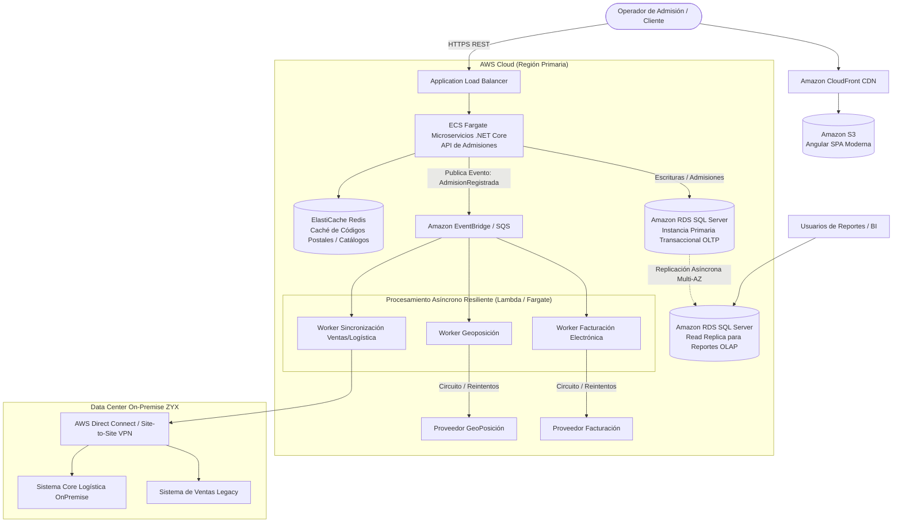

# Solución Técnica Integral: Prueba para Líder Técnico
**Empresa:** INTER RAPIDÍSIMO S.A.  
**Candidato:** Líder Técnico de Desarrollo y Arquitectura Cloud  
**Fecha:** Octubre 2026  

---

# PARTE 1: Respuestas a Preguntas de Conceptos Clave (Nivel Líder Técnico)

### 1. ¿Cómo optimizarías una consulta lenta en SQL Server?
**Rta//.** Aplicaría un proceso metódico de diagnóstico y afinamiento en 5 etapas:
1. **Análisis de Métricas y Planes de Ejecución:** Extraer el *Actual Execution Plan* mediante SQL Server Management Studio (SSMS) o Extended Events, analizando advertencias de costos altos (operadores *Table Scan*, *Index Scan*, *Hash Match* o derrames en `TempDB`).
2. **Revisión de Indexación:** Verificar si faltan índices sugeridos (*Missing Index Details*) o si los existentes sufren de fragmentación elevada ($>30\%$) o estadísticas desactualizadas (`UPDATE STATISTICS`), forzando estimaciones erróneas de cardinalidad.
3. **Optimización Sintáctica T-SQL (SARGability):**
   * Eliminar funciones sobre columnas en cláusulas `WHERE` (ej. cambiar `WHERE YEAR(Fecha) = 2026` por rangos `WHERE Fecha >= '2026-01-01' AND Fecha < '2027-01-01'`).
   * Reemplazar subconsultas correlacionadas o cursores fila por fila por operaciones basadas en conjuntos (`JOIN`, `APPLY` o Window Functions).
   * Evitar `SELECT *` y proyectar únicamente las columnas estrictamente requeridas para permitir *Covering Indexes*.
4. **Paralelismo y Concurrencia:** Evaluar el `CXPACKET` wait type para detectar skew de CPU, ajustando el *Cost Threshold for Parallelism* o utilizando el hint `OPTION (RECOMPILE)` en consultas parametrizadas con problemas de *Parameter Sniffing*.
5. **Aislamiento y Bloqueos:** Implementar `READ COMMITTED SNAPSHOT ISOLATION` (RCSI) a nivel de base de datos para evitar que las lecturas bloqueen escrituras y viceversa.

---

### 2. ¿Cuál es la diferencia entre un índice clustered y un índice non-clustered?
**Rta//.**
* **Índice Clustered (Agrupado):**
  * **Estructura física:** Define el **orden físico real** en el que se almacenan las filas de datos en las páginas de disco. El nivel hoja (*leaf level*) del árbol B-Tree **es la tabla misma**.
  * **Límite:** Solo puede existir **uno por tabla**, habitualmente asociado a la Llave Primaria.
  * **Uso ideal:** Consultas de búsqueda por rangos (`BETWEEN`, `>`, `<`), ordenamientos naturales (`ORDER BY`) y búsquedas de alta frecuencia por ID.
* **Índice Non-Clustered (No Agrupado):**
  * **Estructura física:** Estructura independiente y separada físicamente de la tabla. El nivel hoja contiene las columnas indexadas y un **puntero** (*Row Locator*) que señala a la fila real (el *Clustered Key* si la tabla está agrupada, o un RID si es un Heap).
  * **Límite:** Hasta 999 por tabla en SQL Server.
  * **Uso ideal:** Búsquedas por igualdad en claves secundarias (ej. `Email`, `DocumentoIdentidad`, `NumeroGuia`), filtros frecuentes en `WHERE` y como *Covering Indexes* empleando la cláusula `INCLUDE(...)` para resolver la consulta completa sin requerir un costoso *Key Lookup*.

---

### 3. Explica qué servicios tecnológicos utilizarías o cómo implementarías una arquitectura escalable en AWS para una aplicación .NET Core
**Rta//.** Diseñaría una arquitectura en 3 capas desacopladas, elástica y orientada a eventos:
* **Capa Edge y Distribución:**
  * **Amazon Route 53** con políticas de enrutamiento por latencia/salud.
  * **AWS WAF** integrado a **Amazon CloudFront** para filtrado de ataques L7 (SQLi, XSS, rate limiting) y CDN para assets estáticos.
* **Capa de Cómputo y Orquestación:**
  * **Application Load Balancer (ALB)** en subredes públicas para distribución HTTPS y SSL Offloading.
  * **AWS ECS Fargate** (Serverless Containers) alojando la API .NET Core en subredes privadas. Permite autoescalado horizontal (Target Tracking basado en CPU o peticiones por segundo) sin gestionar instancias de SO.
* **Capa de Datos y Almacenamiento:**
  * **Amazon RDS for SQL Server** en configuración Multi-AZ desplegado en subredes aisladas.
  * **Amazon ElastiCache (Redis)** como caché distribuida L2 para reducir la carga de lectura en la base de datos hasta en un 80% (patrón *Cache-Aside*).
* **Desacoplamiento Asíncrono:**
  * **Amazon SQS / EventBridge** para procesar tareas pesadas (generación de facturas, sincronización de guías logísticas) mediante microservicios worker en background.
* **Gestión de Configuración y Seguridad:**
  * **AWS Secrets Manager** para credenciales dinámicas y rotación de contraseñas.
  * **Amazon CloudWatch + AWS X-Ray** para observabilidad, métricas y trazabilidad distribuida.

---

### 4. ¿Cuál es la diferencia entre EC2 y Lambda en AWS y en qué casos usarías cada uno?
**Rta//.**

| Criterio | Amazon EC2 | AWS Lambda |
| :--- | :--- | :--- |
| **Modelo** | IaaS (Infraestructura como Servicio) - Servidor virtual completo. | Serverless / FaaS (Función como Servicio). |
| **Gestión** | El cliente administra el SO, parches, seguridad de red y runtime. | AWS administra el runtime, escalado, alta disponibilidad e infraestructura. |
| **Escalabilidad** | Basada en Auto Scaling Groups (minutos para inicializar instancias). | Instantánea y automática por cada evento (milisegundos). |
| **Tiempo de Ejecución**| Continuo e ilimitado (24/7). | Límite máximo de 15 minutos por invocación. |
| **Costos** | Pago continuo por instancia provisionada, esté activa o inactiva. | Pago por milisegundo de ejecución y volumen de invocaciones. |

* **Cuándo usar EC2:** Aplicaciones monolíticas legadas con dependencias a nivel de sistema operativo (servicios de Windows, drivers ODBC específicos), procesos batch que superan los 15 minutos de ejecución o cargas predecibles de alto tráfico 24/7 donde instancias reservadas resultan más económicas.
* **Cuándo usar Lambda:** Procesamiento reactivo impulsado por eventos (procesar un archivo recién subido a S3, procesar mensajes de una cola SQS, webhooks externos de facturación o geoposición) y microservicios con tráfico variable o intermitente.

---

### 5. ¿Cómo manejarías credenciales y secretos de conexión en AWS para una aplicación .NET?
**Rta//.** Mediante el principio de **Cero Texto Plano** y delegación de identidades con IAM:
1. **Almacenamiento Seguro:** Guardar cadenas de conexión, API keys y llaves privadas en **AWS Secrets Manager** con cifrado en reposo mediante **AWS KMS**.
2. **Autenticación sin Claves (IAM Roles):** La aplicación .NET Core en ECS Fargate no contiene llaves `AWS_ACCESS_KEY_ID`. Utiliza una política asignada a la tarea (**ECS Task Role**) con permisos mínimos (`secretsmanager:GetSecretValue`) sobre el ARN del secreto específico.
3. **Integración Nativa en .NET:** En el arranque de la aplicación (`Program.cs`), utilizar el proveedor de configuración de AWS (`Amazon.Extensions.Configuration.SystemsManager` o el cliente SDK de Secrets Manager) para inyectar el secreto directamente en el árbol `IConfiguration` en memoria.
4. **Inyección en Tiempo de Despliegue (Recomendada en ECS):** Configurar la directiva `secrets` en el `TaskDefinition.json` de ECS referenciando el ARN de Secrets Manager, permitiendo que el agente de ECS inyecte la variable de entorno en memoria al contenedor antes de inicializar la aplicación.

---

### 6. ¿Qué ventajas tiene implementar CI/CD en un equipo de desarrollo?
**Rta//.**
1. **Detección Temprana de Errores (Shift-Left):** La ejecución automática de linters, escaneos de seguridad estática (SAST) y pruebas unitarias/integración en cada pull request previene la introducción de bugs en ramas principales.
2. **Reducción Drástica del Time-to-Market:** Permite entregas frecuentes, pequeñas e incrementales a producción (horas en lugar de semanas).
3. **Eliminación del Error Humano:** Los pasos manuales propensos a fallos (compilación local, copiado manual de archivos, scripts ejecutados por terminal) se reemplazan por pipelines deterministas y auditables.
4. **Despliegues Libres de Tiempo de Inactividad:** Facilita estrategias de despliegue avanzadas como *Blue/Green* o *Canary*, mejorando la disponibilidad del negocio.
5. **Cultura de Responsabilidad Compartida:** Aumenta la confianza del equipo al garantizar que cualquier commit en la rama principal es potencialmente desplegable.

---

### 7. ¿Cómo manejarías el versionamiento y los despliegues rollback en un entorno de producción con CI/CD?
**Rta//.**
* **Estrategia de Versionamiento:**
  * **Versionamiento Semántico (SemVer - `MAJOR.MINOR.PATCH`):** Etiquetado automático (`Git Tags`) mediante herramientas como *GitVersion* o *Conventional Commits*.
  * **Imágenes de Contenedores Inmutables:** Etiquetar cada imagen en Amazon ECR con el hash del commit (`git-sha`) y el tag SemVer (`v1.2.3`). Queda estrictamente prohibido desplegar la etiqueta mutable `latest` en producción.
* **Estrategia de Despliegue y Rollback:**
  * **Despliegue Blue/Green o Canary (con AWS ECS + CodeDeploy / ArgoCD):** Se levanta el nuevo conjunto de contenedores (Green) y el balanceador (ALB) redirige progresivamente el tráfico (ej. 10% ➔ 50% ➔ 100%).
  * **Rollback Automático por Alarmas:** Si las métricas de CloudWatch detectan un incremento en códigos de error HTTP 5xx o latencia anómala durante el despliegue, el pipeline cancela el paso de tráfico y revierte automáticamente al ambiente anterior (Blue) en segundos sin intervención humana.
  * **Rollback de Base de Datos:** Las migraciones de base de datos deben ser **compatibles hacia atrás** (*Expand/Contract Pattern*). Nunca se eliminan o renombran columnas en la misma versión que el código nuevo; se añaden columnas opcionales primero, se despliega la API, y en una fase posterior se remueven los artefactos obsoletos.

---

### 8. Explica una diferencia clave entre ASP.NET MVC y ASP.NET Core MVC
**Rta//.**
* **Diferencia Fundamental: Arquitectura de Runtime y Multiplataforma.**
  * **ASP.NET MVC (Legacy):** Estaba fuertemente acoplado al runtime de **.NET Framework completo** y dependía estructuralmente de la biblioteca `System.Web.dll`, lo que obligaba a ejecutar exclusivamente sobre servidores **Windows e Internet Information Services (IIS)**.
  * **ASP.NET Core MVC:** Fue rediseñado desde cero como un framework modular y liviano que corre sobre el runtime multiplataforma moderno (.NET Core / .NET 8/9). Es completamente agnóstico al sistema operativo (ejecuta nativamente en **Linux, macOS y contenedores Docker ligeros** como Alpine/Chiseled), utiliza el servidor web ultrarrápido **Kestrel** y posee un pipeline de middleware basado en `RequestDelegate` con inyección de dependencias (DI) nativa de primer nivel.

---

### 9. ¿Cómo garantizarías la seguridad en una API REST desarrollada en .NET Core?
**Rta//.** A través de una estrategia de **Defensa en Profundidad (Defense in Depth)**:
1. **Autenticación y Autorización:** Implementar OAuth 2.0 / OpenID Connect con tokens Bearer JWT validados en cada petición (firma, issuer, audience y expiración), respaldados por autorización basada en roles (RBAC) o directivas por Claims/Policies.
2. **Cifrado de Comunicaciones:** Forzar HTTPS mediante HSTS (`UseHsts`) y TLS 1.3, rechazando tráfico plano HTTP.
3. **Validación Exhaustiva de Entradas:** Validar todos los modelos de entrada mediante librerías como *FluentValidation* antes de procesar la lógica de negocio, sanitizando entradas para prevenir inyecciones SQL y ataques XSS.
4. **Protección de Cabeceras y CORS:** Configuración estricta de CORS restringiendo orígenes, métodos y headers permitidos, complementado con cabeceras de seguridad (`X-Content-Type-Options: nosniff`, `X-Frame-Options: DENY`, `Content-Security-Policy`).
5. **Mitigación de Denegación de Servicio:** Implementar *Rate Limiting* nativo de .NET 8/9 (`app.UseRateLimiter`) a nivel de IP y token para evitar abusos y scraping.
6. **Gestión de Errores Segura:** Middleware global que emita respuestas estandarizadas RFC 7807 (`ProblemDetails`), evitando fugas de información sensible como Stack Traces o cadenas de conexión en entornos no-desarrollo.

---

### 10. ¿Cuándo preferirías usar ADO.NET sobre Entity Framework y por qué?
**Rta//.** Preferiría usar **ADO.NET (o micro-ORMs basados en ADO.NET como Dapper)** sobre Entity Framework en los siguientes escenarios:
1. **Operaciones Batch / Carga Masiva de Datos:** En escenarios logísticos donde se deben insertar o actualizar miles de registros de guías, tracking o paquetes en segundos (usando `SqlBulkCopy`), donde el Change Tracker y la generación de sentencias individuales de EF Core introducen una degradación crítica de CPU y memoria.
2. **Procesos Críticos de Ultra-Baja Latencia:** En transacciones de alta concurrencia donde cada microsegundo cuenta y se requiere ejecutar T-SQL altamente optimizado con lectura directa vía `SqlDataReader` sin sobrecarga de mapeo de entidades.
3. **Reportes Complejos y Consultas Analíticas Avanzadas:** Consultas que involucran CTEs jerárquicos, hints específicos (`WITH (NOLOCK, INDEX(...))`), llamadas a Procedimientos Almacenados complejos o tablas temporales dinámicas donde EF Core genera consultas subóptimas o no ofrece soporte idiomático directo.

---

# PARTE 2: Solución al Caso de Estudio (Compañía de Logística ZYX)

## 1. Diagnóstico de la Problemática Actual

| Problema Identificado en ZYX | Causa Raíz Técnica | Impacto en la Operación y Rentabilidad |
| :--- | :--- | :--- |
| **Recursos Insuficientes On-Premise** | Servidores físicos con capacidad finita no elástica ante picos de admisión logística. | Caída del sistema en temporadas pico (Black Friday, festivos), pérdida de transacciones y cuellos de botella en admisión. |
| **Degradación de Base de Datos** | La misma base de datos procesa transacciones de admisión mientras genera reportes gerenciales pesados. | Bloqueos de tablas (*Lock Escalation*), saturación de I/O de disco y caídas generales del Core transaccional. |
| **Integración Deficiente con Ventas y Logística** | Acoplamiento síncrono punto a punto o transferencias por archivos batch sin validación contractual. | Inconsistencia de inventario, retrasos de actualización de envíos y pérdida de visibilidad de trazabilidad. |
| **Retrasos en Proveedores Externos (Geo/Facturación)** | Llamadas HTTP síncronas bloqueantes a APIs externas durante el flujo de admisión. | La lentitud o caída del proveedor de geoposición/facturación congela el proceso de admisión del usuario final (*Cascade Failure*). |
| **Errores Humanos en Admisión** | Interfaz monolítica obsoleta, sin validaciones reactivas en vivo ni diseño ergonómico guiado por pasos (*Wizard*). | Retrabajo operativo, paquetes con direcciones erróneas, retrasos de entrega y costos adicionales por devolución. |

---

## 2. Propuesta de Arquitectura de Modernización (Nube Híbrida AWS + OnPremise)

La solución adopta el patrón **CQRS (Command Query Responsibility Segregation)**, una arquitectura **Orientada a Eventos (Event-Driven)** y la modernización de la experiencia de usuario.

### 2.1 Diagrama de Arquitectura de la Nueva Plataforma (Mermaid)



---

## 3. Plan de Mitigación Detallado

### 3.1 Solución a Recursos Insuficientes y Escalabilidad
* **Migración a AWS ECS Fargate (.NET Core):** Sustituir la infraestructura rígida On-Premise por contenedores serverless en subredes privadas. Se configuran políticas de escalado automático horizontal (*Target Tracking*) para aumentar dinámicamente tareas ante incrementos repentinos de admisiones.

### 3.2 Solución a la Degradación de la Base de Datos (CQRS de Persistencia)
* **Separación Transaccional vs Lectura/Reportes:**
  * **Comandos (Escrituras de Admisión):** Dirigidas exclusivamente al nodo primario de **Amazon RDS for SQL Server**.
  * **Consultas y Reportes:** Dirigidas a una **Read Replica** dedicada. Ningún reporte gerencial o analítico tiene permisos de ejecución sobre el nodo primario transaccional, eliminando el 100% de los cuellos de botella por contención de bloqueos.
  * **Caché en Memoria:** Implementación de **ElastiCache Redis** para catálogos estáticos (tarifas, ciudades, departamentos, terminales), reduciendo lecturas a disco.

### 3.3 Solución a los Retrasos de Proveedores Externos (Patrón Outbox + Colas)
* **Desacoplamiento Asíncrono:** La admisión del envío **no espera** la respuesta de los proveedores externos.
  1. El operador registra la admisión y recibe confirmación inmediata en menos de 300 ms.
  2. La API emite un evento `AdmisionCreada` hacia una cola **Amazon SQS**.
  3. Workers independientes procesan la geocodificación y la facturación electrónica en segundo plano.
  4. **Patrón Circuit Breaker y Reintentos Exponenciales (Polly):** Si el proveedor de geocodificación se degrada o cae, las peticiones se encolan con reintentos y *Dead Letter Queues* (DLQ), sin congelar la operación del operario en ventanilla.

### 3.4 Solución a la Integración Deficiente con Ventas y Logística
* **Broker Central de Eventos (EventBridge / Kafka):** Se establece un contrato canónico de eventos de dominio en JSON. Cuando ocurre un cambio en admisión, ventas o logística, los sistemas se sincronizan mediante suscripciones a eventos a través de **AWS Direct Connect / VPN Site-to-Site**, garantizando consistencia eventual y eliminando discrepancias manuales.

### 3.5 Solución a los Errores Humanos (Modernización de Frontend)
* **Single Page Application en Angular con Signals:**
  * **Diseño Orientado a Pasos (Wizard Ergonómico):** División del proceso en: 1. Remitente/Destinatario ➔ 2. Paquete y Tarifación ➔ 3. Confirmación.
  * **Validación Reactiva en Vivo:** Validación en tiempo real de campos (código postal, pesos volumétricos, teléfonos) evitando envíos incompletos.
  * **Autocompletado Inteligente y Geocodificación en Cliente:** Normalización de direcciones asistida con debounce para reducir errores tipográficos en un 90%.

---

## 4. Hoja de Ruta de Implementación (Roadmap)

```text
Fase 1: Quick Wins (Semanas 1-4)
├─ Implementación de Read Replica en BD para aislar reportes pesados.
└─ Optimización de índices críticos y activación de RCSI en SQL Server.

Fase 2: Prototipado y Piloto Cloud (Semanas 5-8)
├─ Construcción de la SPA Angular (Wizard ergonómico de admisión).
├─ Despliegue de la API REST .NET Core en ECS Fargate con Terraform.
└─ Desacoplamiento asíncrono con colas SQS para facturación y geoposición.

Fase 3: Conectividad Híbrida y Despliegue Total (Semanas 9-12)
├─ Interconexión de eventos hacia sistemas de ventas y logística OnPremise.
├─ Monitoreo integral con CloudWatch y trazabilidad distribuida con X-Ray.
└─ Salida a producción gradual mediante despliegue Canary por sedes piloto.
```
