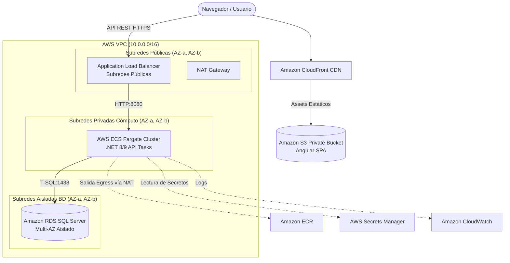

# Especificación de Arquitectura Cloud en AWS (`05-cloud-architecture.md`)

## 1. Visión General y Topología
* **Proveedor Cloud:** Amazon Web Services (AWS).
* **Filosofía:** Cero ClickOps, aprovisionamiento exclusivo con Terraform modular, aislamiento estricto de red y principio de mínimo privilegio en IAM.

---

## 2. Diagrama de Topología de Red (Mermaid)



---

## 3. Segmentación de Red y Seguridad (VPC)
1. **Subredes Públicas (2 AZs):**
   * Alojan exclusivamente el Application Load Balancer (ALB) y el NAT Gateway.
   * Tablas de enrutamiento con salida a Internet Gateway (IGW).
2. **Subredes Privadas de Cómputo (2 AZs):**
   * Alojan las tareas de AWS ECS Fargate que ejecutan la API .NET Core.
   * Sin IPs públicas. Salida a internet unidireccional a través de NAT Gateway exclusivamente para descargar imágenes de ECR o resolver endpoints de AWS.
3. **Subredes Aisladas de Base de Datos (2 AZs):**
   * Alojan Amazon RDS for SQL Server.
   * **Cero conectividad a internet:** Sin ruta hacia IGW ni NAT Gateway.
   * Security Group de RDS solo autoriza ingreso en puerto 1433 originado desde el Security Group de las tareas ECS.

---

## 4. Gestión de Secretos y Configuración
* **AWS Secrets Manager:**
  * Almacena: `db_connection_string` y `jwt_signing_key`.
  * La definición de la tarea en ECS Fargate inyecta estos valores en tiempo de ejecución utilizando la directiva `secrets` con referencia por ARN:
    ```json
    "secrets": [
      {
        "name": "ConnectionStrings__DefaultConnection",
        "valueFrom": "arn:aws:secretsmanager:us-east-1:123456789012:secret:app/db-conn-xyz"
      },
      {
        "name": "Jwt__SecretKey",
        "valueFrom": "arn:aws:secretsmanager:us-east-1:123456789012:secret:app/jwt-key-xyz"
      }
    ]
    ```
* Prohibido cualquier valor sensible en texto plano en repositorios o en `environment`.

---

## 5. Distribución de Frontend
* **Amazon S3 + CloudFront con OAC (Origin Access Control):**
  * Bucket S3 configurado con bloqueo total de acceso público (`BlockPublicAcls = true`).
  * CloudFront como único punto de acceso con redirección obligatoria a HTTPS.
  * Respuestas de error personalizadas: Códigos `403` y `404` se devuelven redirigiendo al archivo `/index.html` con código HTTP `200` para garantizar el enrutamiento del lado del cliente en Angular (SPA).

---

## 6. Módulos de Terraform Requeridos para DevOps
El `agente-devops` estructurará la infraestructura bajo los siguientes módulos:
* `modules/vpc`: VPC, 6 subredes (2 públicas, 2 privadas, 2 aisladas), tablas de ruta, IGW y NAT Gateway.
* `modules/security`: Security Groups (ALB, ECS, RDS) y Roles IAM con principio de mínimo privilegio.
* `modules/database`: Instancia RDS SQL Server Standard/Express, DB Subnet Group, KMS Encryption.
* `modules/ecs-fargate`: Cluster ECS, Task Definition multi-stage, Servicio Fargate, ALB y Target Group (`/healthz`).
* `modules/frontend-s3-cf`: Bucket S3, OAC, distribución de CloudFront y políticas de caché.
* `modules/secrets`: AWS Secrets Manager y políticas de acceso.
