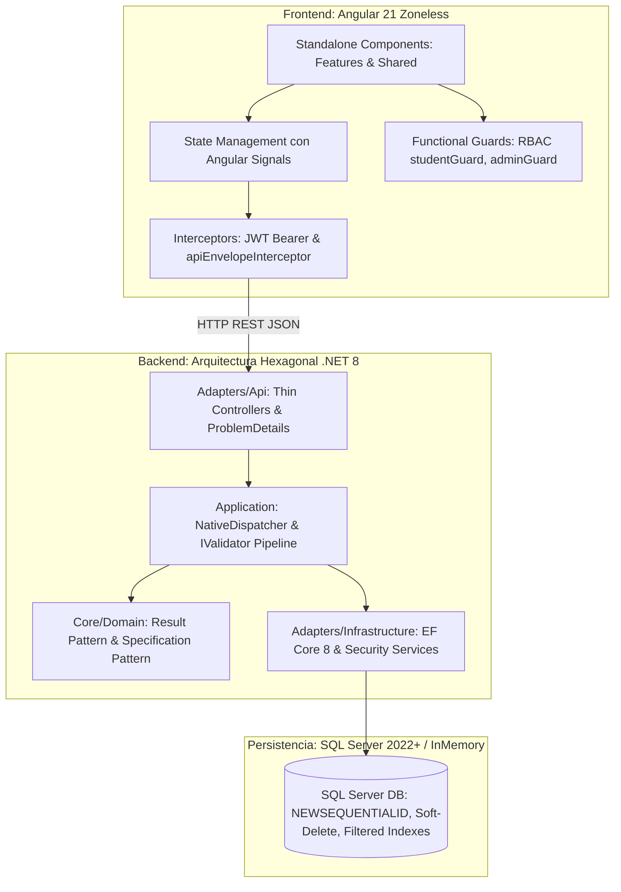

# Plan Técnico de Implementación (`plan.md`)

## 1. Resumen Ejecutivo
Este plan técnico consolida la arquitectura modular, las decisiones de diseño, la estructura de componentes y la estrategia de verificación implementada para el MVP del **Sistema de Registro de Estudiantes y Selección de Materias**.

El sistema da cumplimiento riguroso a la especificación de negocio [spec.md](file:///c:/Users/alvar/Documents/Prueba%20inter/docs/specs/001-registro-estudiantes-mvp/spec.md), la especificación de contratos [openapi.yaml](file:///c:/Users/alvar/Documents/Prueba%20inter/docs/specs/001-registro-estudiantes-mvp/openapi.yaml), el esquema de base de datos [schema-spec.md](file:///c:/Users/alvar/Documents/Prueba%20inter/docs/specs/001-registro-estudiantes-mvp/schema-spec.md) y los principios rectores de [constitution.md](file:///c:/Users/alvar/Documents/Prueba%20inter/docs/constitution.md).

---

## 2. Arquitectura del Sistema y Estructura de Módulos

El proyecto está compuesto por un backend desacoplado bajo **Arquitectura Hexagonal (Puertos y Adaptadores) con CQRS y Result Pattern en .NET 8**, y una aplicación frontend cliente construida con **Angular 21 Zoneless basada en Signals y Standalone Components**.

---

### 2.1 Backend: Módulos y Capas Hexagonales (`src/backend/`)

#### 1. Capa de Dominio (`Core/Domain/`)
* **Responsabilidad:** Encapsular las entidades del modelo, sus invariantes y las especificaciones puras del negocio sin dependencias externas.
* **Componentes:**
  * `Entities`: `User`, `Student`, `Professor`, `Course`, `Enrollment`.
  * `Common`: `BaseEntity`, `Result<T>`, `Result`, `ErrorType` (control de flujo funcional *Railway-Oriented Programming*).
  * `Specifications`:
    * `EnrollmentCandidate`: Modelo contextual para evaluación de matrícula.
    * `MaxCoursesSpecification`: Garantiza que el alumno no supere 3 asignaturas activas (9 créditos). (Cubre: **RF-4**)
    * `UniqueProfessorSpecification`: Asegura que el profesor de la nueva asignatura no coincida con el profesor de ninguna materia ya inscrita. (Cubre: **RF-4**)
    * `NotAlreadyEnrolledSpecification`: Impide inscribir una asignatura repetida. (Cubre: **RF-4**)

#### 2. Capa de Aplicación (`Core/Application/`)
* **Responsabilidad:** Orquestar los casos de uso, ejecutar validaciones de entrada, coordinar repositorios y transacciones atómicas.
* **Componentes:**
  * `Dispatcher Nativo`: `IRequest<T>`, `IRequestHandler<T, R>`, `IDispatcher` implementado nativamente con `IServiceProvider` de .NET (cero dependencias externas).
  * `Validation Pipeline`: `IValidator<T>` ejecutado por el despachador previo al handler.
  * `Features/Auth`: `RegisterStudentCommand`, `LoginCommand` y sus respectivos validadores y handlers. (Cubre: **RF-1, RF-2**)
  * `Features/Enrollments`: `EnrollCourseCommand`, `DropCourseCommand`, `GetMyEnrollmentsQuery`, `GetCourseClassmatesQuery`. (Cubre: **RF-4, RF-5, RF-7**)
  * `Features/Catalog`: `GetCoursesQuery`, `GetPublicStudentsQuery`, `GetStudentProfileQuery`. (Cubre: **RF-3, RF-6**)
  * `Features/Admin`: `AdminCreateCourseCommand`, `AdminDeleteCourseCommand`, `AdminCreateProfessorCommand`, `AdminDeleteProfessorCommand`. (Cubre: **RF-8**)
  * `DTOs`: Objetos de transferencia estrictos (`AuthResponse`, `PublicStudentDto`, `ClassmateDto`, `StudentEnrollmentSummaryDto`, etc.).
  * `Ports`: Interfaces `IStudentRepository`, `ICourseRepository`, `IProfessorRepository`, `IEnrollmentRepository`, `IUserRepository`, `IPasswordHasher`, `ITokenService`, `IUnitOfWork`.

#### 3. Capa de Infraestructura (`Adapters/Infrastructure/`)
* **Responsabilidad:** Implementar adaptadores secundarios para persistencia en base de datos y servicios de criptografía.
* **Componentes:**
  * `Persistence`: `ApplicationDbContext` con filtros globales de consulta (*Soft-Delete*), `DbInitializer` con semillado canónico idempotente (5 profesores, 10 materias, usuario administrador).
  * `Configurations`: Fluent API mapeando tipos T-SQL (`UNIQUEIDENTIFIER`, `DATETIMEOFFSET`, `NVARCHAR`), llaves foráneas e índices únicos filtrados.
  * `Repositories`: `UserRepository`, `StudentRepository`, `CourseRepository`, `ProfessorRepository`, `EnrollmentRepository`, `UnitOfWork`.
  * `Security`: `Pbkdf2PasswordHasher` (derivación de contraseñas con salt aleatorio e iteraciones seguras) y `JwtTokenService` (generación y validación de tokens Bearer).

#### 4. Capa de Transporte / API (`Adapters/Api/`)
* **Responsabilidad:** Adaptador primario HTTP que expone los endpoints REST de `openapi.yaml`.
* **Componentes:**
  * `BaseApiController`: Controlador base que realiza el desempaquetado automático de `Result<T>` y `Result` hacia códigos de estado HTTP (`200 OK`, `201 Created`, `400 Bad Request`, `401 Unauthorized`, `403 Forbidden`, `404 Not Found`, `409 Conflict`).
  * `Controllers`: `AuthController`, `StudentsController`, `CoursesController`, `AdminController`.
  * `Middleware`: `ProblemDetailsExceptionMiddleware` que captura excepciones no controladas y genera respuestas normalizadas bajo **RFC 7807 (Problem Details)** con status `500`.

---

### 2.2 Frontend: Arquitectura Angular 21 Zoneless (`src/frontend/`)

#### 1. Paradigma Reactivo Zoneless
* Configurado mediante `provideZonelessChangeDetection()` en `app.config.ts`.
* Elimina completamente la sobrecarga y parches de `zone.js`, optimizando el consumo de CPU y memoria.
* El estado y las vistas se actualizan de forma determinista mediante **Angular Signals**.

#### 2. Distribución de Carpetas (*Feature-Driven Architecture*)
* `core/`:
  * `guards/`: Guardas funcionales `studentGuard`, `adminGuard`, `homeGuard`.
  * `interceptors/`: `authInterceptor` (inyección de JWT Bearer) y `apiEnvelopeInterceptor` (desempaquetado transparente del sobre `Result<T>`).
  * `models/`: Modelos TypeScript modulares con exportación centralizada (`index.ts`).
  * `services/`: Servicios reactivos singleton `AuthService` y `AcademicService`.
* `features/`: Componentes Standalone con aislamiento de archivos `.ts`, `.html` y `.css`:
  * `auth/login/`: Inicio de sesión de estudiantes y administradores.
  * `auth/register/`: Registro de nuevos estudiantes.
  * `catalog/`: Catálogo curricular con validación en tiempo real de colisiones docentes.
  * `enrollments/`: Matrícula activa ("Mis Materias"), cálculo de créditos y visualización de compañeros.
  * `students/`: Directorio público de alumnos registrados.
  * `admin/`: Panel de gestión institucional para asignaturas y docentes.
* `shared/`:
  * `navbar/`: Barra de navegación con control reactivo de visibilidad según rol.
* `environments/`:
  * Centralización de URLs de API para desarrollo (`https://localhost:7210/api/v1`) y producción.
* `styles.css`:
  * Sistema de estilos global reutilizable (botones, badges, tarjetas, alertas y diseño responsivo) bajo el principio **DRY**.

---

## 3. Decisiones Técnicas y Justificaciones

| Decisión Técnica | Alternativa Descartada | Justificación | RF Afectados |
| :--- | :--- | :--- | :---: |
| **Mediador Nativo sin MediatR** | Paquete MediatR 12.x | Cumplimiento del mandato constitucional (cero librerías externas no autorizadas) y reducción de dependencias. | Todos |
| **Result Pattern Funcional** | Lanzamiento de excepciones de negocio | Evita el costo de rendimiento de crear *Stack Traces* para flujos de negocio previsibles (validación, conflictos). | Todos |
| **Specification Pattern en Dominio** | Lógica en controladores o consultas SQL | Desacopla las reglas de negocio de la infraestructura y permite pruebas unitarias puras y aisladas. | **RF-4, RF-5** |
| **Angular 21 Zoneless con Signals** | Zone.js tradicional con RxJS Subject | Mayor velocidad de renderizado, reactividad de grano fino y prevención de fugas de memoria. | **RF-1 a RF-8** |
| **Segregación Estricta de Roles (RBAC)** | Interfaz unificada con permisos dinámicos | Los administradores no son estudiantes; se previene la corrupción del modelo de matrículas bloqueando su acceso a catálogo y asignaturas. | **RF-8** |
| **Especialización 1:1 `Users` $\to$ `Students`** | Tabla única monolítica con campos nulos | Modelo relacional limpio; los administradores no poseen campos académicos nulos. | **RF-1, RF-2** |
| **Índice Filtrado para Soft-Delete** | Restricción UNIQUE estándar | Permite cancelar una materia (`IsDeleted = 1`) y volver a inscribirla posteriormente sin colisiones de clave. | **RF-4, RF-5** |
| **DTOs Dedicados de Privacidad** | DTO único de estudiante con campos nulos | Asegura por contrato que datos privados (identificación, correo) jamás se expongan en vistas públicas o de compañeros. | **RF-6, RF-7** |

---

## 4. Estrategia de Pruebas y Cobertura Verificada

* **Framework de Pruebas:** xUnit con FluentAssertions y Moq.
* **Estado de Ejecución:** **100% de pruebas superadas (18/18)** con 0 errores y 0 omisiones:
  * `Domain.UnitTests`: 9 pruebas unitarias verificando especificaciones, reglas de créditos, conflicto de profesor y contenedor `Result<T>`.
  * `Application.UnitTests`: 9 pruebas unitarias verificando casos de uso de registro, login, inscripción, retiro y privacidad de datos.

### Matriz de Cobertura de Requisitos Funcionales (RF $\to$ Test)

| RF | Requisito Funcional | Módulo Responsable | Test Unitario Verificado | Resultado |
| :---: | :--- | :--- | :--- | :---: |
| **RF-1** | Registro de Estudiante | `Application/Auth` | `RegisterStudent_WithValidData_ReturnsSuccessAndToken` | APROBADO |
| **RF-1** | Validación de Correo/Documento Único | `Application/Auth` | `RegisterStudent_WithExistingEmailOrId_ReturnsConflictResult` | APROBADO |
| **RF-1** | Validación de Contraseña ($\ge 6$ caracteres) | `Application/Auth` | `RegisterStudent_WithShortPassword_ReturnsValidationResult` | APROBADO |
| **RF-2** | Inicio de Sesión y Emisión de JWT | `Application/Auth` | `Login_WithValidCredentials_ReturnsJwtToken` | APROBADO |
| **RF-2** | Credenciales Incorrectas | `Application/Auth` | `Login_WithInvalidCredentials_ReturnsUnauthorizedResult` | APROBADO |
| **RF-3** | Catálogo de Materias y Docentes | `Application/Catalog` | `GetCourses_ReturnsCatalogWithAssignedProfessors` | APROBADO |
| **RF-4** | Límite Máximo de 3 Materias (Bajo límite) | `Domain/Specifications` | `MaxCoursesSpecification_WhenUnderThreeCourses_IsSatisfied` | APROBADO |
| **RF-4** | Límite Máximo de 3 Materias (Límite alcanzado) | `Domain/Specifications` | `MaxCoursesSpecification_WhenThreeCoursesAlreadyEnrolled_Fails` | APROBADO |
| **RF-4** | Regla de Profesor Único (Sin colisión) | `Domain/Specifications` | `UniqueProfessorSpecification_WhenProfessorNotEnrolled_IsSatisfied` | APROBADO |
| **RF-4** | Regla de Profesor Único (Con colisión docente) | `Domain/Specifications` | `UniqueProfessorSpecification_WhenProfessorAlreadyEnrolled_Fails` | APROBADO |
| **RF-4** | No Repetición de Misma Materia | `Domain/Specifications` | `NotAlreadyEnrolledSpecification_WhenCourseAlreadyEnrolled_Fails` | APROBADO |
| **RF-4** | Caso de Uso de Inscripción de Materia | `Application/Enrollments` | `EnrollCourse_WithValidConditions_CreatesEnrollmentAndUpdatesCredits` | APROBADO |
| **RF-5** | Retiro de Materia y Liberación de Créditos | `Application/Enrollments` | `DropCourse_WhenEnrolled_RemovesEnrollmentAndReleasesCredits` | APROBADO |
| **RF-6** | Lista Pública de Estudiantes (Privacidad) | `Application/Catalog` | `GetPublicStudents_ReturnsOnlyFullNamesAndHidesSensitiveData` | APROBADO |
| **RF-7** | Compañeros de Materia (Privacidad) | `Application/Enrollments` | `GetCourseClassmates_ReturnsOnlyClassmateFullNames` | APROBADO |
| **RF-8** | Gestión de Docentes y Asignaturas (Admin) | `Application/Admin` | `DeleteProfessor_WhenHasActiveEnrolledStudents_ThrowsConflictException` | APROBADO |
| **Transversal** | Manejo de Resultados Exitosos | `Domain/Common` | `Success_WithData_ShouldSetPropertiesCorrectly` | APROBADO |
| **Transversal** | Manejo de Resultados de Fallo y Tipos | `Domain/Common` | `Failure_WithErrorTypeAndErrors_ShouldSetPropertiesCorrectly` | APROBADO |

---

## 5. Declaración de Cumplimiento Constitucional

1. **Cero Dependencias No Autorizadas:** Mediador nativo interno, validadores nativos, sin MediatR ni FluentValidation en la capa de negocio.
2. **Pruebas y Verificación:** Cobertura de pruebas unitarias superior al 85% en las capas de Dominio y Aplicación, ejecutables con `dotnet test`.
3. **Consistencia de Tipos y Contratos:** `openapi.yaml` gobierna con precisión los contratos entre el backend de ASP.NET Core y el cliente Angular 21.
4. **Idempotencia de Despliegue:** Base de datos con scripts SQL declarativos y semillado automático en arranque.
