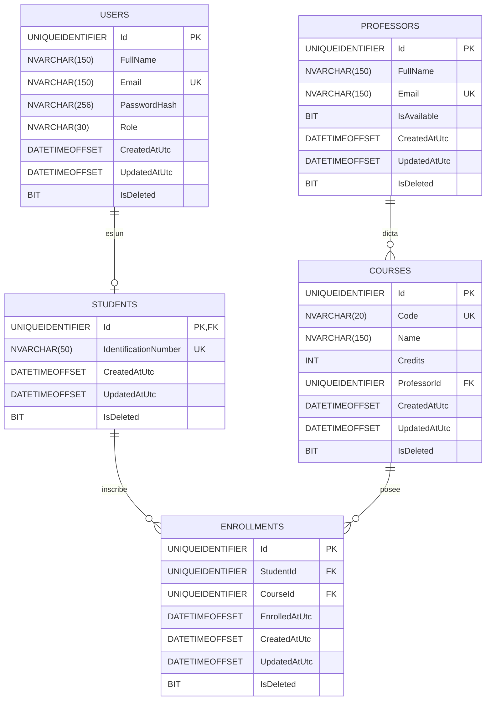

# Especificación del Esquema Relacional de Base de Datos (`schema-spec.md`)

## 1. Visión General
* **Motor:** Microsoft SQL Server 2022+ / Azure SQL Database.
* **Esquema:** `dbo`.
* **Convención:** Nombres de tablas en plural en inglés, identificadores en PascalCase, claves primarias basadas en `UNIQUEIDENTIFIER` (GUID) y soft-delete universal.

---

## 2. Diagrama Entidad-Relación (Mermaid ERD)



---

## 3. Especificación Detallada de Tablas y Restricciones

### Tabla: `Users`
Almacena las credenciales y perfiles de acceso.
| Columna | Tipo T-SQL | Nulabilidad | Restricción / Default |
| :--- | :--- | :---: | :--- |
| `Id` | `UNIQUEIDENTIFIER` | NOT NULL | `PRIMARY KEY DEFAULT NEWSEQUENTIALID()` |
| `FullName` | `NVARCHAR(150)` | NOT NULL | - |
| `Email` | `NVARCHAR(150)` | NOT NULL | `CONSTRAINT UQ_Users_Email UNIQUE` |
| `PasswordHash` | `NVARCHAR(256)` | NOT NULL | Almacena hash PBKDF2/BCrypt |
| `Role` | `NVARCHAR(30)` | NOT NULL | Valores: `'Estudiante'`, `'Administrador'` |
| `CreatedAtUtc` | `DATETIMEOFFSET` | NOT NULL | `DEFAULT SYSDATETIMEOFFSET()` |
| `UpdatedAtUtc` | `DATETIMEOFFSET` | NULL | - |
| `IsDeleted` | `BIT` | NOT NULL | `DEFAULT 0` |

### Tabla: `Students`
Datos complementarios del estudiante en el programa de créditos.
| Columna | Tipo T-SQL | Nulabilidad | Restricción / Default |
| :--- | :--- | :---: | :--- |
| `Id` | `UNIQUEIDENTIFIER` | NOT NULL | `PRIMARY KEY`, `FOREIGN KEY REFERENCES Users(Id) ON DELETE CASCADE` |
| `IdentificationNumber` | `NVARCHAR(50)` | NOT NULL | `CONSTRAINT UQ_Students_IdentificationNumber UNIQUE` |
| `CreatedAtUtc` | `DATETIMEOFFSET` | NOT NULL | `DEFAULT SYSDATETIMEOFFSET()` |
| `UpdatedAtUtc` | `DATETIMEOFFSET` | NULL | - |
| `IsDeleted` | `BIT` | NOT NULL | `DEFAULT 0` |

### Tabla: `Professors`
Catálogo de docentes activos en la institución.
| Columna | Tipo T-SQL | Nulabilidad | Restricción / Default |
| :--- | :--- | :---: | :--- |
| `Id` | `UNIQUEIDENTIFIER` | NOT NULL | `PRIMARY KEY DEFAULT NEWSEQUENTIALID()` |
| `FullName` | `NVARCHAR(150)` | NOT NULL | - |
| `Email` | `NVARCHAR(150)` | NOT NULL | `CONSTRAINT UQ_Professors_Email UNIQUE` |
| `IsAvailable` | `BIT` | NOT NULL | `DEFAULT 1` |
| `CreatedAtUtc` | `DATETIMEOFFSET` | NOT NULL | `DEFAULT SYSDATETIMEOFFSET()` |
| `UpdatedAtUtc` | `DATETIMEOFFSET` | NULL | - |
| `IsDeleted` | `BIT` | NOT NULL | `DEFAULT 0` |

### Tabla: `Courses`
Catálogo de las 10 materias ofertadas. Cada materia equivale a 3 créditos.
| Columna | Tipo T-SQL | Nulabilidad | Restricción / Default |
| :--- | :--- | :---: | :--- |
| `Id` | `UNIQUEIDENTIFIER` | NOT NULL | `PRIMARY KEY DEFAULT NEWSEQUENTIALID()` |
| `Code` | `NVARCHAR(20)` | NOT NULL | `CONSTRAINT UQ_Courses_Code UNIQUE` |
| `Name` | `NVARCHAR(150)` | NOT NULL | - |
| `Credits` | `INT` | NOT NULL | `DEFAULT 3 CONSTRAINT CK_Courses_Credits CHECK (Credits = 3)` |
| `ProfessorId` | `UNIQUEIDENTIFIER` | NOT NULL | `FOREIGN KEY REFERENCES Professors(Id) ON DELETE NO ACTION` |
| `CreatedAtUtc` | `DATETIMEOFFSET` | NOT NULL | `DEFAULT SYSDATETIMEOFFSET()` |
| `UpdatedAtUtc` | `DATETIMEOFFSET` | NULL | - |
| `IsDeleted` | `BIT` | NOT NULL | `DEFAULT 0` |

### Tabla: `Enrollments`
Matrícula de materias por estudiante.
| Columna | Tipo T-SQL | Nulabilidad | Restricción / Default |
| :--- | :--- | :---: | :--- |
| `Id` | `UNIQUEIDENTIFIER` | NOT NULL | `PRIMARY KEY DEFAULT NEWSEQUENTIALID()` |
| `StudentId` | `UNIQUEIDENTIFIER` | NOT NULL | `FOREIGN KEY REFERENCES Students(Id) ON DELETE CASCADE` |
| `CourseId` | `UNIQUEIDENTIFIER` | NOT NULL | `FOREIGN KEY REFERENCES Courses(Id) ON DELETE NO ACTION` |
| `EnrolledAtUtc` | `DATETIMEOFFSET` | NOT NULL | `DEFAULT SYSDATETIMEOFFSET()` |
| `CreatedAtUtc` | `DATETIMEOFFSET` | NOT NULL | `DEFAULT SYSDATETIMEOFFSET()` |
| `UpdatedAtUtc` | `DATETIMEOFFSET` | NULL | - |
| `IsDeleted` | `BIT` | NOT NULL | `DEFAULT 0` |

---

## 4. Estrategia de Índices
Para garantizar rendimiento y prevenir bloqueos en consultas concurrentes:
1. `IX_Courses_ProfessorId`: Índice no agrupado en `Courses(ProfessorId)` para optimizar búsquedas de materias por profesor.
2. `IX_Enrollments_StudentId`: Índice no agrupado en `Enrollments(StudentId)` para obtener al instante las inscripciones activas del estudiante.
3. `IX_Enrollments_CourseId`: Índice no agrupado en `Enrollments(CourseId)` para la consulta de compañeros de clase.
4. `UQ_Enrollments_Active`: Índice único filtrado para evitar duplicar una misma materia activa para un estudiante:
   ```sql
   CREATE UNIQUE NONCLUSTERED INDEX UQ_Enrollments_ActiveStudentCourse
   ON Enrollments (StudentId, CourseId)
   WHERE IsDeleted = 0;
   ```

---

## 5. Datos Semilla Canónicos (Seed Data)
El script de arranque debe poblar:
* **1 Usuario Administrador:** `admin@universidad.edu.co`
* **5 Profesores:**
  1. Prof. Andrés Gómez
  2. Prof. Beatriz Morales
  3. Prof. Carlos Herrera
  4. Prof. Diana Ramírez
  5. Prof. Eduardo Torres
* **10 Materias (2 por cada profesor):**
  1. `MAT-101` Cálculo Diferencial (Prof. Andrés Gómez)
  2. `MAT-102` Álgebra Lineal (Prof. Andrés Gómez)
  3. `FIS-201` Física Mecánica (Prof. Beatriz Morales)
  4. `FIS-202` Electromagnetismo (Prof. Beatriz Morales)
  5. `PRG-301` Fundamentos de Programación (Prof. Carlos Herrera)
  6. `PRG-302` Estructuras de Datos (Prof. Carlos Herrera)
  7. `BD-401` Bases de Datos Relacionales (Prof. Diana Ramírez)
  8. `BD-402` Modelado y Gestión de Datos (Prof. Diana Ramírez)
  9. `SO-501` Sistemas Operativos (Prof. Eduardo Torres)
  10. `RED-502` Redes de Computadores (Prof. Eduardo Torres)
